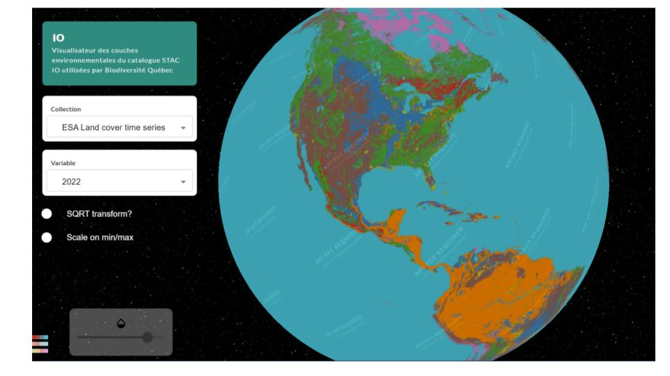
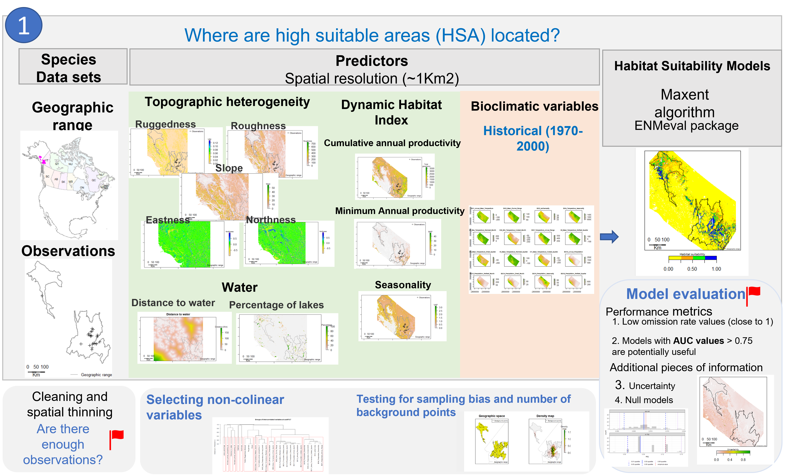
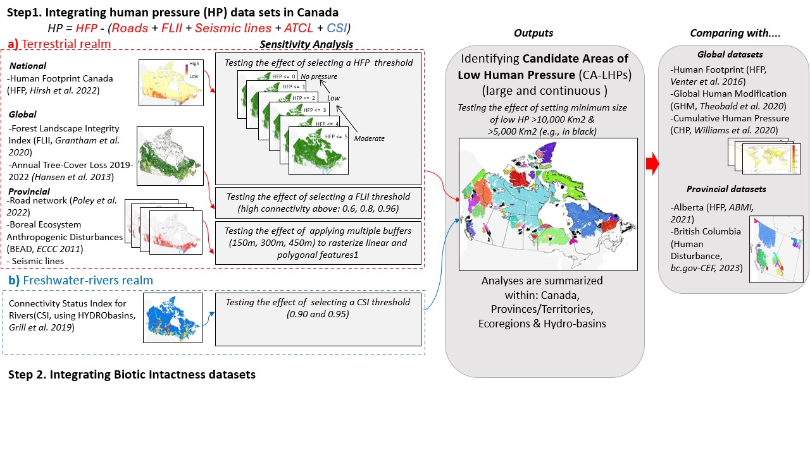

::: {style="text-align: justify;"}
My professional experience spans leadership, field ecology, spatial analysis, and applied research. As a project manager, I have led interdisciplinary teams, engaged diverse stakeholders, and overseen sustainable development and conservation initiatives from planning through execution and evaluation. My background also includes extensive fieldwork establishing flora and fauna baselines and evaluating environmental impacts, as well as roles as a spatial analyst and institutional researcher developing workflows, coding and decision-support tools to evaluate predictive models and guide local, national and global conservation efforts.
:::

::: {.callout-note collapse="true"}
## Statistical Ecologist - Alberta Biodiversity Monitoring Institute. Calgary, Canada (2025-2026).

The Alberta Biodiversity Monitoring Institute ([ABMI](https://abmi.ca/abmi-home)) is a provincial leader in biodiversity monitoring and a nationally recognized model for government agencies and research institutions across Canada. Through broad collaboration, the ABMI provides timely, relevant, and scientifically credible data on Alberta's living resources to support informed decision-making.

*My role:*

I worked as a Statistical Ecologist at the ABMI, responsible for creating tools to support environmental management in Alberta, and all across Canada. I leveraged R software and tools to develop interactive web applications, incorporating spatial data to deliver meaningful insights. Using GitHub for version control, I systematically tracked project progress and ensured clean code collaboration. Beyond technical development, I dedicated substantial time to technical writing---authoring comprehensive user guidelines and a publication-ready manuscript. Additionally, I co-organized and facilitated workshops focused on model evaluation tools to empower users and foster collaborative learning.

*Accomplishments:*

-   I co-developed [**sdmEvaluationTool**](https://github.com/LandSciTech/sdmEvaluationTool), an interactive R Shiny application designed to help users evaluate the reliability, utility, and potential risks of species distribution models (SDMs) in conservation decision-making. The tool enables stakeholders to assess model performance before applying findings to real-world management strategies. Currently, beta testing is underway to refine the user experience and ensure robust performance.
-   I co-developed a **decision-support tool** that allows stakeholders to identify and prioritize key evaluation criteria for SDMs based on their specific biodiversity conservation and management objectives. To support wider adoption and methodology transparency, I am currently co-authoring a manuscript detailing the framework for model evaluation criteria.
:::

::: {.callout-note collapse="true"}
## Research Associate, McGill University. Montreal, Canada (2021- 2025).

*Supervisor: [Dr. Andrew Gonzalez](https://www.thegonzalezlab.org/)*

::: panel-tabset
## 1. Bon in a Box (GEO BON)

*Partners: [GEO BON](https://geobon.org/), Microsoft, Canada (McGill University, Université de Sherbrooke, Université Concordia and Université de Montréal) and Colombia (Humboldt Institute)*.

BON in a Box is an open-source, collaborative platform developed by the Group on Earth Observations Biodiversity Observation Network (GEO BON) to help scientists, conservationists, and policymakers monitor biodiversity and report on global goals. This infrastructure empowers nations to effectively monitor biodiversity change and make data-driven conservation decisions. What is in the Box?



*My role:*

As a Research Associate at McGill University, I developed end-to-end spatial data workflows and engineered automated R pipelines to calculate Essential Biodiversity Variables (EBVs) and ecological indicators. In addition to executing complex spatial analyses, I synthesized extensive peer-reviewed literature, authored technical user guidelines, and co-authored a research manuscript to showcasing the BON in a box collaborative platform.

*Accomplishments:*

-   I developed automated pipelines for ecological modeling. For technical details and source code, explore the [BON in a Box GitHub Repository](https://github.com/GEO-BON/bon-in-a-box-pipelines)

-   Collaborated to develop the Spatio Temporal Asset Catalog (STAC, see [STAC Viewer GEO BON](https://stac.geobon.org/viewer/chelsa-clim/bio1)) to support the implementation of EBVs and biodiversity indicators. [STAC Catalog GitHub Repository](https://stac.geobon.org/viewer/chelsa-clim/bio1).

*Publications:*

Griffith, J., .... **J. Zuloaga**, et al. [BON in a Box:An Open and Collaborative Platform for Biodiversity Monitoring, Indicator Calculation, and Reporting](https://academic.oup.com/bioscience/article/76/4/345/8424339)

Click on this figure to access the STAC catalog (a collection of environmental layers):

[{fig-align="left" width="700"}](https://io.biodiversite-quebec.ca/viewer/oiseaux-nicheurs-qc/tyrannus_tyrannus_pocc_2017)

## 2. Models and Tools (Parks Canada)

*Partner: Parks Canada*

This work contributes to a Parks Canada initiative that collaborates with diverse partners to build the foundational knowledge required for conservation across the Hudson--James Bay Lowlands (HJBL). The initiative focuses on protecting the region's exceptional biodiversity alongside its critical carbon stocks and fluxes across wetland, peatland, and coastal ecosystems. The HJBL plays a vital role in global climate regulation while providing essential ecosystem services---such as water retention and regulation, wild foods, and biocultural practices---that sustain the livelihoods and cultural heritage of local Indigenous communities.

*My role:*

I synthesized extensive peer-reviewed literature, grey literature, and web platforms to evaluate models, tools, and frameworks for monitoring biodiversity, ecosystem services, and scenario assessments. To communicate these findings effectively, I authored a comprehensive final report, developed an interactive R Shiny summary dashboard, and convened an expert workshop with leading practitioners in the field to foster collaborative insights.

*Accomplishments:*

-   I led the development of a [**HJBL toolbox**](https://juanzuloaga.github.io/GEOBON_Toolbox/) incorporating ecological models, analytical tools, and standardized approaches to measure, monitor, and evaluate biodiversity and ecosystem services. Tailored specifically to the Hudson-James Bay Lowlands (HJBL) and broader northern ecosystems in Canada, this framework provides essential decision-support for regional conservation and environmental monitoring.

-   I developed a **Summary for decision makers** [here](https://drive.google.com/file/d/1oXubgTNqVXvzyzegXht__KH44X44qM5l/view?usp=sharing).

{fig-align="center" width="800"}
:::

#### 
:::

::: {.callout-note collapse="true"}
## Postdoctoral Researcher, McGill University. Montreal, Canada (2019-2021)

*Supervisor: [Dr. Andrew Gonzalez](https://www.thegonzalezlab.org/)*

::: panel-tabset
## 1. Key Biodiversity Areas

*Partner: Wildlife Conservation Society (Co-supervisors: Ciara Raudsepp-Hearne and Justina Ray)*

The Key Biodiversity Areas (KBAs) Initiative is a worldwide conservation planning tool aimed to identify potential sites that might contribute significantly to the global persistence of biodiversity ([IUCN 2016](https://portals.iucn.org/library/node/49131)).  It was designed to include multiple facets of biodiversity, spanning from species to communities and ecosystems. The KBA guidelines [(IUCN 2016)](https://portals.iucn.org/library/node/49131) suggest five high-level strategic criteria for its implementation: Threatened Biodiversity (A), Geographically Restricted Biodiversity (B), Ecological Integrity (C), Biological Processes (D), and Irreplaceability (E). Since 2017, more than 16,000 sites have been identified globally ([KBA dashboard](https://www.keybiodiversityareas.org/en/dashboard), visited in November 2024) and 188 in Canada ([KBA Canada](https://gis.natureserve.ca/portal/apps/dashboards/ad84def2aef04ecabb3b38982764f59e) dashboard, visited in November 2024), mostly under criteria A, B and D.

*My role:*

I developed automated R pipelines and spatial analysis workflows to identify potential Key Biodiversity Areas (KBAs) across Canada for species that might trigger criteria A and B (threatened and geographically restricted species, respectively). Additionally, I led the development of a novel methodological approach to operationalize the Ecological Integrity criterion---prioritizing expansive landscapes with low industrial footprints and thriving biological communities to ensure robust, scalable application within national and global conservation frameworks.

#### 1.1. Habitat Suitability Models

*Accomplishments:*

-   I developed a **pipeline to implement habitat suitability models (HSMs, see some results [here](https://quebio.ca/kba/MAcro_KBAs_HSMs_Sites_Canada.html).)** to help identify potential areas for [Key Biodiversity Areas (KBAs) in Canada](https://kbacanada.org/). See [GitHub repository for pipeline](https://github.com/GonzalezBiodiversityLab/HSMs_KBAs_Canada?tab=readme-ov-file). We ran the pipelines for a group of 96 species, that might trigger some KBA's criteria, as a proof of concept aimed to provide recommendations for a full implementation (\~ 1,200 species). The figure below shows the metodological framework for implementing HSMs.

{fig-align="center" width="1000"}

#### 1.2. Implementing the Ecological Integrity (EI) criterion

*Accomplishments:*

-   I led a national **scoping analysis** that integrated comprehensive global and national data sets on human pressures and biotic intactness across Canada's terrestrial and freshwater ecosystems. Through this work, I identified Candidate Areas of Low Human Pressure and characterized their underlying biotic intactness, establishing a data-driven foundation for ongoing conservation planning and prioritization. (manuscript in progress).

Figure 1. General scoping analysis approach to implement the EI in Canada. In **Step1** we identify Candidate Areas of Low Human Pressure (CA-LHPs) in Canada by subtracting from the national human footprint dataset for Canada  (HFP-Can by [Hirsh-Pearson et al. 2022](https://www.facetsjournal.com/doi/full/10.1139/facets-2021-0063)) a compilation of multiple global, national and provincial and territorial datasets from  **a**) terrestrial realm (human footprint, roads, seismic lines, etc.), and **b**) freshwater realm (Connectivity Status Index for rivers (CSI) within HYDRObasins). **c)** We tested multiple assumptions (e.g., effect of multiple HFP-Can thresholds, multiple buffers to rasterize vector datasets and minimum size of continuous area of low human pressure). **d)** We also compared our results with global and provincial datasets. In **Step 2**: Characterized the BI of these CA-LPHs.

## The Nature Conservancy

*Partner: The Nature Conservancy of Canada*

#### 2.1. Habitat Suitability Models

*My role:*

I collaborated directly with NCC to adapt the technical framework and pipelines built for the KBAs to meet their specific regional conservation priorities and land management objectives.

*Accomplishments:*

Building on our work with Key Biodiversity Areas (KBAs), Nature Conservancy Canada (NCC) engaged our team to customize and implement our automated R pipelines and spatial workflows. See GitHub scripts [here](https://github.com/GonzalezBiodiversityLab/HSM_NCC).
:::
:::

::: {.callout-note collapse="true"}
## GIS Specialist, World Wildlife Fund. Toronto, Canada (2011)

*Supervisors: James Snider and Steven Price*

[Free-flowing Rivers](https://wwf.ca/habitat/freshwater/free-flowing-rivers/) is an initiative of World Wildlife Fund-Canada (WWF-Canada) to ensure Canada's wild rivers remain wild for the wildlife and people who depend on them.

*My role:*

I conducted spatial and network analyses to estimate the status of environmental rivers flows in Canada.

I collected, cleaned, and properly organized the HydroSHEDS hydrography data set for Canada, including quality control, node layers creation and stream order attribution to the network). Then, I applied spatial (e.g., ArcGIS: model Builder and Python) and network analyses ([RivEx -- a network processing tool](https://www.rivex.co.uk/)) to evaluate the impact of various infrastructure features on rivers in Canada and to estimate the status of environmental flows and forecast likely future conditions of rivers network in Canada.

*Accomplishments:*

-   **Generated multi-scale maps** illustrating the status of free-flowing rivers across Canada, ranging from sub-basin to basin levels.

-   **Developed reproducible spatial workflows** to calculate river connectivity status, designed for easy replication and updating as new data becomes available.

-   **Built a centralized geodatabase** to store analytical results, enabling end-users to query, consult, and customize the outputs.

*Publications:*

My work and results was used to create this report:

Crochetiere et al. (2017). [Wild and free-flowing: Identifying and safeguarding Canada's wild rivers](https://wwf.ca/wp-content/uploads/2020/03/Wild-and-free-flowing_2017.pdf). WWF-Canada. 38p.

The figure shows and example of rivers altered by dams in Canada.

{#fig-my-pdf-plot width="100%" height="650px"}
:::

::: {.callout-note collapse="true"}
## Project Manager, Departamento Administrativo de la Presidencia de Colombia (2002-2003)

The government of Colombia developed a set of programs aimed to prevent, reduce, and eliminate the illicit cultivation of narcotic-producing plants (such as coca, opium poppy, or cannabis) by replacing them with legal, sustainable, and profitable economies in vulnerable rural areas.

*Role:*

-   Coordinated the implementation, performance monitoring, and reporting of alternative development programs aimed at sustainable land use and illicit crop substitution.

*Accomplishments*:

-   Contributed to the design and rollout of the *Forest Keeper Families Program* (*Familias Guardabosques*), empowering local communities to eliminate illegal crops while actively monitoring and restoring tropical forest ecosystems.

-   Authored comprehensive technical performance reports and briefs for parliamentary and government stakeholders to evaluate program efficacy and guide strategic policy decisions.
:::

::: {.callout-note collapse="true"}
## Project Coordinator, Fondo para la Acción Ambiental. Bogotá, Colombia (2001-2002)

In Colombia, *Fondo Acción* (the Fund for Environmental Action and Childhood) is a non-profit organization established in 2000 through a binational agreement between the governments of Colombia and the United States. It manages funds and finances projects dedicated to biodiversity conservation, tropical forest protection, sustainable natural resource management, and early childhood development.

*My role and accomplishments:*

-   I developed standardized application forms, evaluation guidelines, and procedural documentation for organizations seeking environmental protection funding.

-   I authored comprehensive proposal guides to assist applicants in designing high-impact, science-backed environmental project proposals.
:::

::: {.callout-note collapse="true"}
## Project Coordinator. Universidad Nacional de Colombia (1998-2000).

::: panel-tabset
## Wildlife conservation portafolio

The Ministry of Environment developed a strategy to access World Bank funding for the protection and management of wildlife in Colombia. To this end, the National University of Colombia (*Universidad Nacional*) was commissioned to build a project portfolio addressing the needs not only of academia, such as scientific research, but also of NGOs, local communities, indigenous communities, and various productive sectors, with the goal of protecting and sustainably managing fauna across all regions of Colombia.

*My role:*

-   **Program Development:** Spearheaded a wildlife conservation project portfolio, establishing standardized application procedures, proposal templates, and comprehensive guidelines to assist NGOs and universities in securing funding for fauna management.

-   **Stakeholder Outreach & Engagement:** Led regional outreach initiatives, delivering over 30 presentations to universities, non-profits, and research institutions to drive high-quality proposal submissions for wildlife protection and management.

*Accomplishments:*

-   **Technical Evaluation & Portfolio Management:** Evaluated and categorized 400+ project proposals based on maturity and developmental stage, streamlining the review and selection pipeline for conservation grants.

## Strategies for protecting non-forest ecosystems

The Ministry of Environment planned to define conservation strategies for non-forest ecosystems in Colombia, including savannas, *páramos*, arid zones, and wetlands. To support this effort, the National University of Colombia (*Universidad Nacional*) was commissioned to synthesize baseline knowledge on each ecosystem's spatial extent, physical determinants (geology and hydrography), flora and fauna, major threats, socioeconomic stressors, human impacts, and local and Indigenous populations, alongside recommendations for sustainable management and economic activities.

*My role*:

-   Coordinated an interdisciplinary team.

-   Developed a comprehensive literature review.

-   Organized a database, including multiple aspects for each ecosystems.

*Accomplishments*:

-   **Synthesized baseline data and formulated sustainable management strategies** to protect critical non-forest ecosystems in Colombia, including savannas, *páramos*, arid zones, and wetlands.
:::
:::

::: {.callout-note collapse="true"}
## Project Manager, GeoIngenieria. Bogotá, Colombia (1995-2001)

GeoIngeniería Ltda. (now part of Antea Group) is a multidisciplinary engineering and environmental consultancy that provides specialized technical, scientific, and regulatory expertise, guiding public and private sector clients in minimizing environmental risk and ensuring sustainable outcomes across complex infrastructure and resource projects.

*My role and accomplishments:*

-   **EIA Leadership & Compliance:** Led multidisciplinary teams in developing and delivering over 40 Environmental Impact Assessments (EIAs) for oil exploration and production projects, ensuring strict adherence to regulatory frameworks, industry standards, and corporate objectives.

-   **Technical Integration & GIS Analytics:** Synthesized complex physical, biological, and socioeconomic datasets across spatiotemporal scales within a GIS environment to characterize environmental baselines, assess cumulative impacts, and inform spatial planning.

-   **Field Research & Biodiversity Inventories:** Designed and executed extensive terrestrial (flora and fauna) and hydrobiological field surveys to establish ecological baselines and evaluate ecosystem vulnerability in operational areas.

-   **End-to-End Project Management:** Managed project life cycles from proposal design and budgeting to cost control, work plan execution, and site supervision, delivering high-quality documents on time and within scope.

-   **Stakeholder & Regulatory Liaison:** Coordinated technical communications, reports, and presentations for regulatory authorities, corporate leadership, and local stakeholders to secure environmental permits and align project goals.

-   **Team Building & Quality Management:** Recruited and mentored junior scientists in biological survey methodologies and environmental assessment frameworks; implemented ISO 9000 quality management standards to standardize workflow procedures.
:::

::: {.callout-note collapse="true"}
## Instructor, Universidad Javeriana. Bogotá, Colombia (1999-2000)

Designed and delivered course modules examining Colombia's major biogeographic regions and ecosystems. Emphasis on macroecological patterns and biophysical drivers (e.g., climate seasonality, geomorphology, and hydrologic regimes) controlling ecosystem boundaries from high-altitude Páramos to lowland rainforests.
:::
