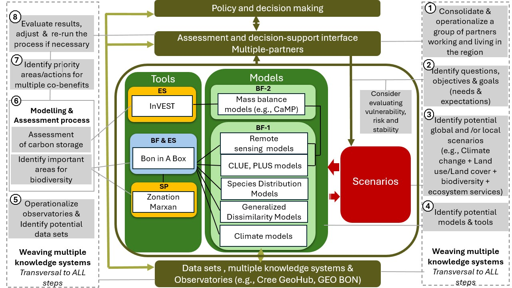
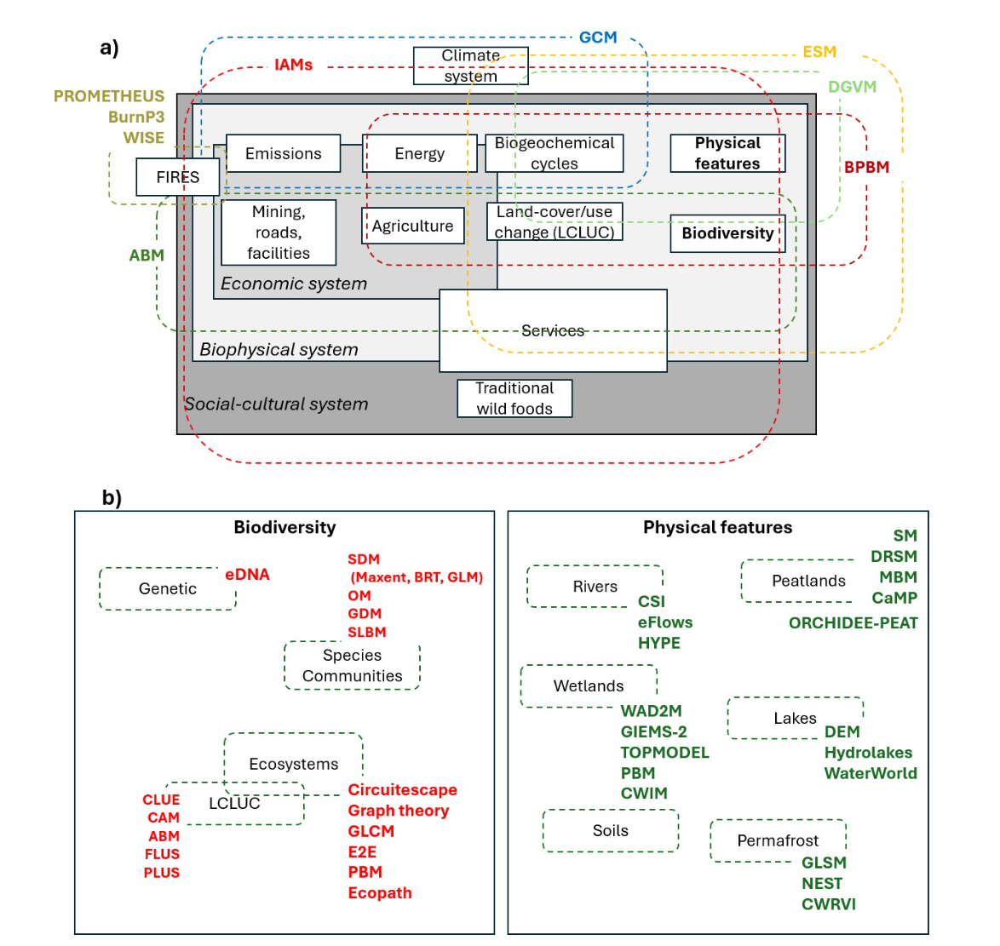
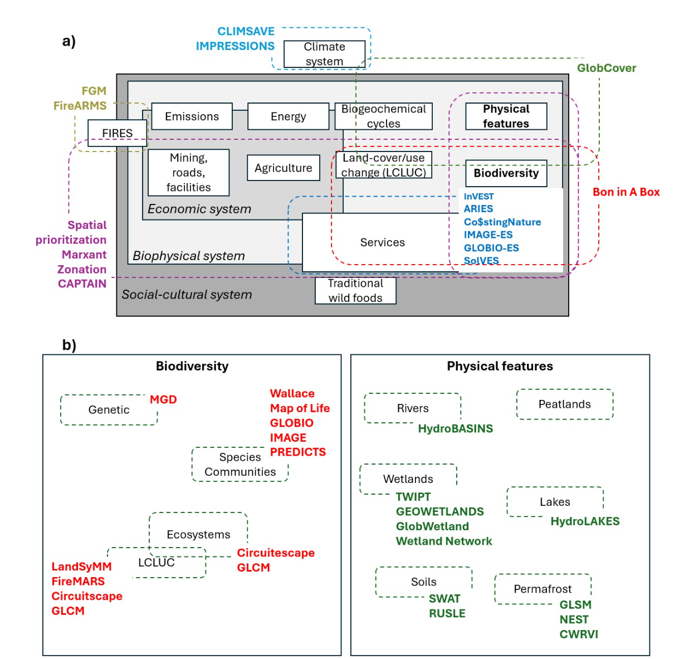

## Research Associate (2021- Present).

*McGill University (Gonzalez Lab) and GEO BON.*

*Supervisor: [Dr. Andrew Gonzalez](https://www.thegonzalezlab.org/)*

#### 1. Models and Tools for Hudson James Bay Lowlands

*Partner: Parks Canada (Karen Richardson)*

I developed a [Toolbox of models, tools and approaches](https://juanzuloaga.github.io/GEOBON_Toolbox/) for measuring, monitoring and evaluating biodiversity and ecosystem services in the Hudson James Bay Lowlands (HJBL) and northern ecosystems in Canada.

::: {.callout-note collapse="true"}
### See a summary here

We used the [IPBES (2016)](https://www.ipbes.net/document-library-catalogue/methodological-assessment-report-scenarios-and-models-biodiversity-and) conceptual framework that provides guidance for the use of scenarios, models and tools for implementing regional and global assessments, designing policy and management strategies and addressing gaps in data and knowledge relevant to biodiversity and ecosystem services, among others.

{fig-align="center" width="600"}

"Models" are qualitative or quantitative descriptions of key components of a system and of relationships between those components ([IPBES 2016](https://www.ipbes.net/document-library-catalogue/methodological-assessment-report-scenarios-and-models-biodiversity-and)). Models are built to measure, assess and monitor multiple aspects of biophysical, economic and socio-cultural systems (see some examples in the **Figure below**)

Tools have been developed to operationalize the systematic use of these models. Multiple institutions and initiatives have developed and maintained tools that house models described above. For instance, [Bon in A Box](https://boninabox.geobon.org/) a [GEO BON](https://geobon.org/) global initiative, is in the process of developing multiple data-to-indicator pipelines to help biodiversity and ecosystem services assessment and monitoring. InVEST, ARIES and Co\$tingNature are tools for ecosystem services assessment. Marxan, Zonation, and CAPTAIN are tools for spatial prioritization.  The **Figure below** shows some tools that can support assessment and inform multiple partners in the HJBL.

:::

## 

#### 2. [Bon in a Box](https://boninabox.geobon.org/): developing pipelines

*Partner: [GEO BON](https://geobon.org/)*

I developed pipelines for ecological modelling and the creation of a STAC Catalog to support the implementation of Essential Variables and Biodiversity Indicators to help countries monitoring biodiversity change. For more information see [Bon in a Box GitHub repo](https://github.com/GEO-BON/bon-in-a-box-pipelines), the [user interface for some examples](https://biab2.geobon.org/pipeline-form) and the [STAC Catalog](https://biodiversite-quebec.ca/en/documentation/r-io) ([GitHub repo](https://github.com/BiodiversiteQuebec/stac-catalogue/tree/main)). Project Partners: Microsoft, Canada (McGill University, Université de Sherbrooke, Université Concordia and Université de Montréal) and Colombia (Humboldt Institute).

::: {.callout-note collapse="true"}
## Example in Bon in A Box to calculate Climate Velocity (see interface [here](http://localhost:7972/about.html))

{width="1200"}

Note that *Outputs* can be used as an *Input* to further calculations in a pipeline
:::

## Postdoctoral Researcher (2019 - 2021)

*McGill University*

*Supervisor: [Dr. Andrew Gonzalez](https://www.thegonzalezlab.org/)*

*Partner: Wildlife Conservation Society (Co-supervisors: Ciara Raudsepp-Hearne and Justina Ray)*

#### 1. Habitat Suitability Models

I developed a pipeline to implement habitat suitability models (HSMs) to help identify potential areas for [Key Biodiversity Areas (KBAs) in Canada](https://kbacanada.org/). See [GitHub repo for pipeline](https://github.com/GonzalezBiodiversityLab/HSMs_KBAs_Canada?tab=readme-ov-file).

::: {.callout-note collpase="true"}
## Workflow to identify high suitability areas for species triggering KBAs' criteria A1 and B1

:::

#### 2. Implementing the Ecological Integrity criterion

I developed a scoping analysis based on a compilation of the most comprehensive sets of global and national datasets of human pressure and biotic intactness for terrestrial and freshwater ecosystems in Canada. I identified Candidate Areas of Low Human Pressure and characterized their biotic intactness. 
