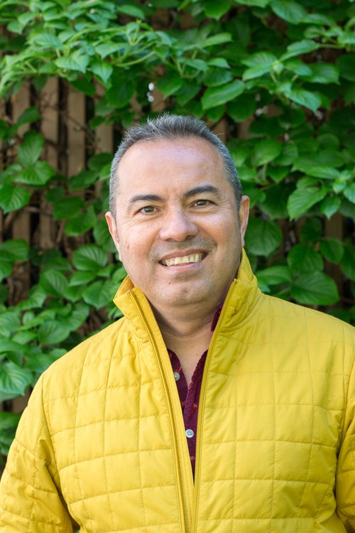

---
format:
  html:
    self-contained: true
    link-external-icon: true
    link-external-newwindow: true
    css:  styles.css
toc: false
editor: visual
---

# Juan Zuloaga, PhD.



<h4>***Biodiversity Conservation Scientist***</h4>

::: {style="text-align: justify;"}
#### I am a biodiversity conservation scientist who turns complex ecological data into practical solutions for nature and people.
:::

::: {style="text-align: justify;"}
#### Working across sectors, I lead interdisciplinary teams to design, implement, and evaluate strategies that protect wildlife, restore natural habitats, foster sustainable local livelihoods, and advance national and global biodiversity targets.
:::

```{=html}
<div style="position: fixed; bottom: 15px; right: 15px; z-index: 1000; width: 200px;">
  <a href="https://mapmyvisitors.com/web/1c9l9"  title="Visit tracker"></a>
</div>
```
